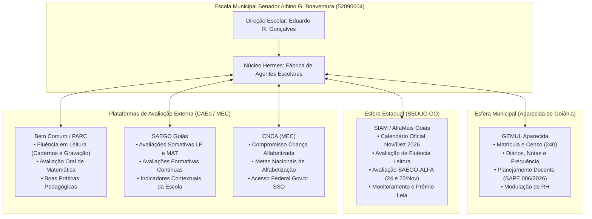

# Relatório Técnico Integrado: Mapeamento dos 5 Portais Educacionais Oficiais
## Fábrica de Agentes Escolares — E.M. Senador Albino Gonçalves Boaventura
**Município:** Aparecida de Goiânia – Goiás  
**Código Inep / Censo:** `52090604` | **Código Unidade Municipal (GEMUL):** `240`  
**Gestor Responsável:** Eduardo Rodrigues Gonçalves (`CPF: 92937934153` / `Matrícula: 21057`)  
**Data de Emissão:** 01/11/2026  
**Classificação Documental:** `DOC-DAD-001`  

---

## 1. Visão Geral Executiva

Este documento consolida o mapeamento técnico, estrutural, administrativo e pedagógico dos **5 sistemas governamentais e plataformas educacionais** que alimentam a tomada de decisões da Escola Municipal Senador Albino Gonçalves Boaventura.

A integração unifica as esferas **Municipal (SME Aparecida)**, **Estadual (SEDUC-GO / AlfaMais)** e **Federal / Avaliações Externas (MEC / CAEd / Associação Bem Comum)** em um único cérebro digital auditável, operado pela arquitetura multiagente do Hermes Agent.



---

## 2. Relatório Analítico por Portal

---

### 2.1. GEMUL — Sistema de Gestão Educacional Municipal
* **Endereço Oficial:** `https://gemul-aparecida.com.br/login/index.asp`
* **Órgão Mantenedor:** Secretaria Municipal de Educação (SME) de Aparecida de Goiânia
* **Identificação Funcional:**
  * Gestor: `Eduardo Rodrigues Gonçalves` (Usuário: `eduardo.rodrigues` / ID: `68`)
  * Cargo: `DIRETOR(A) - INTEGRAL` (Matrícula Funcional: `21057`)
  * Unidade Escolar Selecionada: `240 - ESCOLA MUNICIPAL SENADOR ALBINO GONÇALVES BOAVENTURA`
* **Arquitetura Tecnológica:**
  * Servidor ASP Clássico com formulário POST tradicional.
  * Autenticação em dois estágios: login de credenciais seguido da seleção dinâmica de unidade escolar no endpoint `selecionar_escola.asp`.
  * Manutenção de estado baseada em cookies de sessão do servidor IIS/ASP.
* **Comunicado Normativo Vigente:**
  * **Comunicado SAPE nº 006/2026:** Substituição irrevogável do antigo sistema de *Lançamento de Conteúdo Programático* pela ferramenta integrada **Planejamento**.
* **Módulos Mapeados no Sistema:**
  1. **Acadêmico (`/app/academico.asp`):** Lançamento de notas dos 4 bimestres, registro de faltas, geração de atas de conselho de classe e consolidação do diário escolar.
  2. **Matrícula (`/gemul2015/Sistema/MAT/DEFAULT.ASP`):** Controle de vagas, confirmação de matrículas, transferências ativas/passivas e movimentação de turmas.
  3. **Planejamento (`/app/planejamento.asp`):** Pautas curriculares, planejamento semanal dos professores e alinhamento com a Matriz Curricular Municipal.
  4. **Recursos Humanos (`/sistema/SRH/default.asp`):** Quadro docente, modulação horária, atestados, registros funcionais e faltas abonadas.
  5. **Censo Escolar (`chaveAcesso.asp`):** Emissão de chaves e dados sincronizados com a base do Educacenso / MEC.
  6. **Avap/Atividades (`/sistema/EAD/DEFAULT.ASP`):** Repositório de atividades educacionais digitais municipais.
  7. **Tutoriais (`/app/tutorial.asp`):** Manuais oficiais de operação e fluxos normativos da SME.
* **Automação Hermes:** Script [executar_login_gemul.py](file:///c:/HERMES%20ESCOLA/agentes/tecnologia-automacao/executar_login_gemul.py).

---

### 2.2. Associação Bem Comum — Plataforma PARC
* **Endereço Oficial:** `https://bemcomum.caeddigital.net/`
* **Órgão / Parceria:** Associação Bem Comum & Centro de Políticas Públicas e Avaliação da Educação (CAEd / UFJF)
* **Identificação Funcional:**
  * Gestor: `Eduardo Rodrigues Gonçalves` (CPF: `92937934153`)
  * Perfil: `Diretor(a) Escolar` (Código de Perfil: `1021`)
  * Unidade Escolar Vinculada: `52090604 - ESCOLA MUNICIPAL SENADOR ALBINO G BOAVENTURA`
  * Regional: `CRE Aparecida de Goiânia` (Código: `13330100000102`) | Rede: `13081680200000002`
* **Arquitetura Tecnológica:**
  * Single Page Application (SPA) em AngularJS com UI-Router (`#!/minhapagina`).
  * Backend REST em Parse Server (`https://bemcomum.caeddigital.net/portal/functions/` e `https://api.caeddigital.net/parc/v1/`).
  * Autenticação via Session Token armazenado no `localStorage` sob a chave `168-parc.usuario`.
* **Módulos e Recursos Mapeados:**
  1. **Avaliações da Fluência em Leitura (`#!/avaliacao/1005/organizacao`):** Cadernos de testes oficiais para o 2º ano, manuais para aplicadores e gabaritos orais.
  2. **Avaliações Orais de Matemática (`#!/avaliacao/1007/acompanhamento`):** Painel de conferência e sincronização de áudios das avaliações do 1º ano.
  3. **Administração de Escolas e Profissionais (`#!/administracao/escolas`, `#!/administracao/profissionais`):** Homologação cadastral e credenciamento da equipe de aplicação.
  4. **Desenvolvimento Profissional:** Catálogo de boas práticas e intervenções pedagógicas direcionadas para estudantes com dificuldades graves de leitura.
* **Automação Hermes:** Script [executar_login.py](file:///c:/HERMES%20ESCOLA/agentes/tecnologia-automacao/executar_login.py) e [extrator_detalhado_bemcomum.py](file:///c:/HERMES%20ESCOLA/agentes/tecnologia-automacao/extrator_detalhado_bemcomum.py).

---

### 2.3. CNCA — Compromisso Nacional Criança Alfabetizada
* **Endereço Oficial:** `https://criancaalfabetizada.caeddigital.net/#!/login`
* **Órgão Mantenedor:** Ministério da Educação (MEC) / Governo Federal / CAEd Digital
* **Status no Sistema:** **Autenticado e Integrado (Sessão Ativa Gov.br SSO)**
* **Identificação Funcional:**
  * Gestor: `Eduardo Rodrigues Gonçalves` (CPF: `92937934153` / Email: `eduardovirtualgyn@gmail.com`)
  * Perfis Vinculados:
    1. `Diretora ou Diretor Escolar` (Código: `1021`) — E.M. Senador Albino Gonçalves Boaventura (`52090604`)
    2. `Professora ou Professor` (Código: `1072`) — E.M. Senador Albino Gonçalves Boaventura (`52090604`)
  * Token de Sessão Parse: `r:a470229c94bba896ea3a0ff8913c1e5c` (Chave `225-alfabetizacao.usuario`)
  * Código do Programa / Rede: `CD_REDE: "3"` | `FL_TEMPO_APRENDER: "1"`
* **Arquitetura Tecnológica e Extração ao Vivo:**
  * Plataforma CAEd Digital SPA autenticada com sucesso via **Gov.br SSO** em sessão interativa com extração via Scrapling.
  * Capturadas 19 chamadas de APIs de backend (`/portal/functions/login`, `getAgregados`, `getObjetosByView`, `CV001`).
* **Aviso Oficial de Ação Imediata (MEC):**
  * *"Atenção: Atualize os dados cadastrais dos estudantes com informações de cor ou raça e pertencimento ao público-alvo da educação especial."* (Rota: `/#!/lista-turmas`).
* **11 Módulos Operacionais Mapeados:**
  1. **Cronograma (`/#!/cronograma`):** Calendário nacional e prazos de lançamento de notas/respostas.
  2. **Novidades (`/#!/novidades`):** Informes oficiais e atualizações do MEC.
  3. **Profissionais (`/#!/profissionais`):** Cadastro de equipes escolares para apoio à alfabetização.
  4. **Turmas (`/#!/lista-turmas`):** Relação de turmas e auditoria de autodeclaração de raça/cor e educação especial.
  5. **Avaliações (`/#!/avaliacoes`):** Testes e materiais instrucionais para os 1º e 2º anos.
  6. **Banco de Itens (`/#!/banco-itens`):** Montagem de cadernos pedagógicos customizados.
  7. **Resultados (`/#!/resultados`):** Dados de participação e proficiência nas avaliações formativas.
  8. **Matrizes (`/#!/matrizes`):** Matrizes de habilidades e descritores de competência.
  9. **Monitoramento (`/#!/monitoramento`):** Indicadores de alcance do programa na unidade.
  10. **Desenvolvimento Profissional (`/#!/capacitacao`):** Cursos de formação em avaliação educacional.
  11. **Apoio Pedagógico (`/#!/apoio-pedagogico`):** Roteiros de intervenção e boas práticas de alfabetização.
* **Automação Hermes:** Script [executar_cnca_ao_vivo.py](file:///c:/HERMES%20ESCOLA/agentes/tecnologia-automacao/executar_cnca_ao_vivo.py) e launcher [abrir_cnca_ao_vivo.bat](file:///c:/HERMES%20ESCOLA/abrir_cnca_ao_vivo.bat).

---

### 2.4. SIAM — Sistema Integrado de Administração da Educação (SEDUC-GO)
* **Endereço Oficial:** `https://siam.educacao.go.gov.br/login`
* **Órgão Mantenedor:** Secretaria de Estado da Educação de Goiás (SEDUC-GO) — Programa AlfaMais Goiás
* **Identificação Funcional:**
  * Gestor: `Eduardo Rodrigues Gonçalves` (CPF: `92937934153` / Email: `eduardovirtualgyn@gmail.com`)
  * Perfil: `Diretor Escola` (Código do Perfil: `15`)
  * Unidade Vinculada: `52090604 - Escola Mun. Senador Albino Gonçalves Boa Ventura`
  * Regional: `CRE-APARECIDA` (Código: `126`) | Município: `APARECIDA DE GOIÂNIA` (`520301001405`)
* **Arquitetura Tecnológica:**
  * Modern SPA em Vite com consumo de endpoints REST seguros via Bearer JWT.
  * Autenticação via `POST /api/Auth`, persistida em `sessionStorage` (`alfaUser`).
* **Calendário Oficial e Janela de Avaliações (Novembro e Dezembro 2026):**
  * **02 a 06/11/2026:** Formação Municipal & **Aplicação da Avaliação de Fluência Leitora (Fase 1)**.
  * **09 a 13/11/2026:** **Aplicação da Avaliação de Fluência Leitora (Fase 2 / Repescagem)**.
  * **16/11/2026:** Prazo Final para envio do Relatório das Formações Municipais.
  * **24 e 25/11/2026:** **Aplicação Oficial da Avaliação SAEGO-ALFA** (Conexão direta com o SAEGO).
  * **18/12/2026:** Término do Ano Letivo e Conselho de Classe Final.
* **Módulos do Sistema Mapeados:**
  1. **Início (`/inicio`):** Mural de comunicados estaduais, vídeos institucionais e calendário interativo.
  2. **Estudantes (`/estudantes`):** Consulta individual, enturmação e histórico de proficiência leitora.
  3. **Escolas (`/escolas`):** Metas pactuadas pela escola no programa AlfaMais.
  4. **Professores (`/professores`):** Registro de professores alfabetizadores e adesão às formações.
  5. **Acompanhamento (`/acompanhamento`):** Curva de evolução pedagógica e metas de aprendizagem.
  6. **Prêmio (`/premio`):** Critérios de elegibilidade e acompanhamento do Prêmio Leia.
  7. **Painel (`/painel`):** Dashboards comparativos (Escola x Município x Estado de Goiás).
* **Automação Hermes:** Script [executar_login_siam.py](file:///c:/HERMES%20ESCOLA/agentes/tecnologia-automacao/executar_login_siam.py).

---

### 2.5. SAEGO — Sistema de Avaliação Educacional do Estado de Goiás
* **Endereço Oficial:** `https://avaliacaoemonitoramentogoias.caeddigital.net/#!/login`
* **Órgão Mantenedor:** SEDUC-GO / CAEd Digital
* **Identificação Funcional:**
  * Gestor: `Eduardo Rodrigues Gonçalves` (CPF: `92937934153`)
  * Perfil: `Diretor Escolar` (Código: `901`)
  * Unidade Escolar Vinculada: `52090604 - ESCOLA MUNICIPAL SENADOR ALBINO G BOAVENTURA`
  * Regional: `CRE-126` | Município: `APARECIDA DE GOIÂNIA` (`5201405`)
  * Token de Sessão Parse: `r:e1ff4a760c5bfd295008fefdf020b501` (Chave `130-goias.usuario`)
* **Arquitetura Tecnológica:**
  * SPA em AngularJS + Parse Server CAEd (`/portal/functions/login` e `/portal/functions/getObjetosByView`).
  * Mock preventivo injetado para compatibilizar a renderização dinâmica de fórmulas matemáticas (`window.MathJax`).
* **Estrutura de Eixos e Cards no Dashboard:**
  1. **Desenvolvimento Profissional:** *Orientações Pedagógicas* (rotas didáticas interventivas) e *Cadastros* (dados administrativos para planejamento).
  2. **SAEGO (Somativas):**
     * *Organização:* Guias oficiais e cadernos de testes.
     * *Resultados do SAEGO:* Padrões de proficiência em Língua Portuguesa e Matemática (escalas CAEd).
     * *Interposição de Recursos:* Protocolos formais para retificação de notas de estudantes.
     * *Indicadores Contextuais:* Dados dos questionários socioeconômicos e clima escolar da unidade (`CARD_INDICADORES_CONTEXTUAIS_MINHA_PAGINA_2025`).
  3. **Avaliações Formativas:** Cadernos e acompanhamento em tempo real da participação das turmas (`CARD_RES_FOR_2026`).
  4. **Fluência em Leitura:** Alocação de aplicadores e consolidação de resultados (`CARD_RESULTADO_FLUENCIA`).
  5. **Módulos Socioemocionais:** Instrumentos de avaliação e monitoramento do clima socioemocional (`CARD_ORGANIZACAO_SOCIOEMOCIONAL` e `CARD_MONITORAMENTO_SOCIOEMOCIONAL`).
* **Automação Hermes:** Script [executar_login_saego.py](file:///c:/HERMES%20ESCOLA/agentes/tecnologia-automacao/executar_login_saego.py).

---

## 3. Matriz Comparativa e Interoperabilidade Técnica

| Atributo | GEMUL Aparecida | Bem Comum (PARC) | CNCA (MEC) | SIAM (SEDUC-GO) | SAEGO (CAEd/Goiás) |
| :--- | :--- | :--- | :--- | :--- | :--- |
| **Esfera** | Municipal (SME) | Parceria / Terceiro Setor | Federal (MEC) | Estadual (SEDUC-GO) | Estadual (SEDUC-GO / CAEd) |
| **Foco Principal** | Gestão Escolar e Notas | Fluência e Matemática Oral | Alfabetização Nacional | Política AlfaMais Goiás | Avaliações Somativas e Diagnósticas |
| **Pilha Web** | ASP Clássico (POST) | AngularJS SPA (Parse) | AngularJS SPA (Gov.br) | Vite SPA (Vue/React) | AngularJS SPA (Parse Server) |
| **Autenticação** | Sessão ASP + ID Escola | Parse Session Token | Gov.br SSO (hCaptcha) | JWT Bearer Token | Parse Session Token |
| **Identificador Escola** | `240` | `52090604` | `52090604` | `52090604` | `52090604` |
| **Perfil do Gestor** | Diretor(a) - Matr. 21057 | Diretor(a) Escolar (1021) | Diretor (1021) / Prof (1072) | Diretor Escola (15) | Diretor Escolar (901) |
| **Status no Hermes** | **Autenticado e Integrado** | **Autenticado e Integrado** | **Autenticado e Integrado** | **Autenticado e Integrado** | **Autenticado e Integrado** |

---

## 4. Distribuição Operacional entre os Agentes Escolares

```
+-----------------------------------------------------------------------------------------------+
|                       DISTRIBUIÇÃO DE COMPETÊNCIAS NA FÁBRICA DE AGENTES                     |
+-----------------------------------------------------------------------------------------------+

[ Agente 01 - Coordenação Geral ]
 - Monitora o cumprimento do Calendário Oficial do SIAM (janelas de Fluência e SAEGO-ALFA).
 - Supervisiona os prazos de interposição de recursos no SAEGO e comunicados SAPE no GEMUL.

[ Agente 02 - Gestão Pedagógica ]
 - Cruza os diagnósticos de fluência (Bem Comum e SAEGO) com o diário acadêmico do GEMUL.
 - Orienta o corpo docente no módulo 'Planejamento' (SAPE 006/2026).
 - Aplica os cadernos formativos e acompanha as rotas pedagógicas sugeridas pelo CAEd.

[ Agente 03 - Secretaria Escolar ]
 - Garante a consistência dos dados de matrículas, transferências e enturmação no GEMUL.
 - Sincroniza periodicamente o Educacenso via módulo Censo Escolar.
 - Audita cadastros de alunos inscritos no SIAM e no SAEGO.

[ Agente 04 - Gestão de Pessoas ]
 - Coordena a escala de professores aplicadores da avaliação de fluência leitora.
 - Acompanha a adesão docente às formações do AlfaMais registradas no SIAM.
 - Controla a modulação horária no módulo de Recursos Humanos do GEMUL.

[ Agente 06 - Inteligência de Dados ]
 - Unifica os relatórios JSON gerados pelos crawlers (`sessao_gemul`, `sessao_siam`, `sessao_saego`).
 - Elabora dashboards de proficiência relacionando nível socioeconômico com rendimento acadêmico.
 - Monitora a taxa de abstenção em dias de prova diagnóstica.

[ Agente 07 - Tecnologia e Automação ]
 - Mantém os scripts assíncronos (`agentes/tecnologia-automacao/`).
 - Monitora renovação de tokens JWT e sessões Parse.
 - Assegura a integridade do isolamento de credenciais locais via `.env` (LGPD).
```
